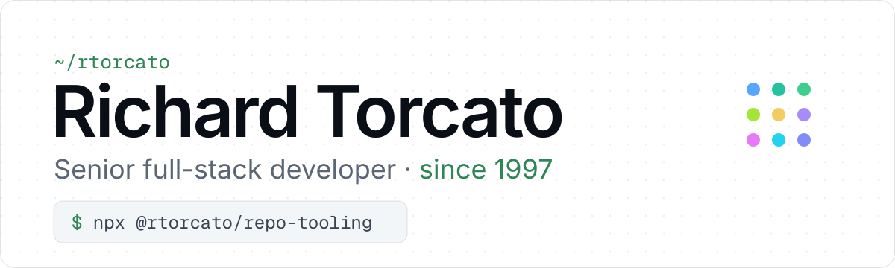

<picture>
  <source media="(max-width: 600px) and (prefers-color-scheme: dark)" srcset="banner/narrow-dark.svg" />
  <source media="(max-width: 600px)" srcset="banner/narrow-light.svg" />
  <source media="(prefers-color-scheme: dark)" srcset="banner/wide-dark.svg" />
  
</picture>

**Senior Full Stack Application Developer · Shipping web and interactive applications**

I'm a full-stack developer who has built internet and interactive applications for major Canadian corporations and marketing firms (IBM, Manulife, Flight Centre, and many more) since the late 90s. I run projects independently from concept through production deployment — backend, frontend, infrastructure, and design.

Today I work across the modern web stack (TypeScript, Next.js, React, Node.js) and Apple platforms (Swift / SwiftUI).

🌐 **Home:** [torcato.dev](https://torcato.dev) — everything I build, in one place

📄 **Resume:** [resume.torcato.dev](https://resume.torcato.dev)

🏢 **Agency:** [Matrix Digital Solutions](https://matrixdigital.com) (founded 1997)

💼 **LinkedIn:** [linkedin.com/in/rtorcato](https://www.linkedin.com/in/rtorcato/)

## 🐍 Activity

<picture>
  <source media="(prefers-color-scheme: dark)" srcset="https://raw.githubusercontent.com/rtorcato/rtorcato/output/github-snake-dark.svg" />
  <source media="(prefers-color-scheme: light)" srcset="https://raw.githubusercontent.com/rtorcato/rtorcato/output/github-snake.svg" />
  
</picture>

---

## 🌟 Featured projects

Open-source TypeScript and Swift packages. They share the same conventions and release pipeline. More at [torcato.dev](https://torcato.dev).

<!-- Taglines come from shared-docs src/family.ts. Icons in icons/ are copies of each repo's apps/docs/static/img/logo-dark.svg (dark) and logo.svg (light); update them here when the marks change. -->

### Libraries

<table>
  <tr>
    <td width="50%" valign="top">
      <a href="https://docs.torcato.dev/js-common/"><picture>
        <source media="(prefers-color-scheme: dark)" srcset="icons/js-common-dark.svg" />
        
      </picture></a>
      
<a href="https://docs.torcato.dev/js-common/"><strong>js-common</strong></a> 
      Tree-shakeable TypeScript utilities — tiny bundles, full type safety, CLI included.

      
&emsp;&emsp;

    </td>
    <td width="50%" valign="top">
      <a href="https://docs.torcato.dev/api-common/"><picture>
        <source media="(prefers-color-scheme: dark)" srcset="icons/api-common-dark.svg" />
        
      </picture></a>
      
<a href="https://docs.torcato.dev/api-common/"><strong>api-common</strong></a> 
      Framework-agnostic building blocks for Node.js APIs — errors, auth, rate limiting, OpenAPI, Express + Hono.

      
&emsp;&emsp;

    </td>
  </tr>
  <tr>
    <td width="50%" valign="top">
      <a href="https://docs.torcato.dev/browser-common/"><picture>
        <source media="(prefers-color-scheme: dark)" srcset="icons/browser-common-dark.svg" />
        
      </picture></a>
      
<a href="https://docs.torcato.dev/browser-common/"><strong>browser-common</strong></a> 
      Tree-shakeable TypeScript wrappers around 40+ browser Web APIs — one subpath per spec.

      
&emsp;&emsp;

    </td>
    <td width="50%" valign="top">
      <a href="https://docs.torcato.dev/db-common/"><picture>
        <source media="(prefers-color-scheme: dark)" srcset="icons/db-common-dark.svg" />
        
      </picture></a>
      
<a href="https://docs.torcato.dev/db-common/"><strong>db-common</strong></a> 
      Shared, tree-shakeable TypeScript database utilities for Node projects.

      
&emsp;&emsp;

    </td>
  </tr>
  <tr>
    <td width="50%" valign="top">
      <a href="https://docs.torcato.dev/cf-common/"><picture>
        <source media="(prefers-color-scheme: dark)" srcset="icons/cf-common-dark.svg" />
        
      </picture></a>
      
<a href="https://docs.torcato.dev/cf-common/"><strong>cf-common</strong></a> 
      Typed TypeScript wrappers and helpers for Cloudflare bindings and APIs.

      
&emsp;&emsp;

    </td>
    <td width="50%" valign="top">
      <a href="https://docs.torcato.dev/react-common/"><picture>
        <source media="(prefers-color-scheme: dark)" srcset="icons/react-common-dark.svg" />
        
      </picture></a>
      
<a href="https://docs.torcato.dev/react-common/"><strong>react-common</strong></a> 
      Published React 19 component library — shared UI primitives.

      
&emsp;&emsp;

    </td>
  </tr>
  <tr>
    <td width="50%" valign="top">
      <a href="https://docs.torcato.dev/supabase-common/"><picture>
        <source media="(prefers-color-scheme: dark)" srcset="icons/supabase-common-dark.svg" />
        
      </picture></a>
      
<a href="https://docs.torcato.dev/supabase-common/"><strong>supabase-common</strong></a> 
      Shared, tree-shakeable TypeScript helpers for Supabase — client, auth, and database utilities.

      
&emsp;&emsp;

    </td>
    <td width="50%" valign="top">
      <a href="https://docs.torcato.dev/swift-common/"><picture>
        <source media="(prefers-color-scheme: dark)" srcset="icons/swift-common-dark.svg" />
        
      </picture></a>
      
<a href="https://docs.torcato.dev/swift-common/"><strong>swift-common</strong></a> 
      SwiftUI package of reusable views and helpers to build apps faster.

      
&emsp;

    </td>
  </tr>
</table>

### Tooling

<table>
  <tr>
    <td width="50%" valign="top">
      <a href="https://docs.torcato.dev/repo-tooling/"><picture>
        <source media="(prefers-color-scheme: dark)" srcset="icons/repo-tooling-dark.svg" />
        
      </picture></a>
      
<a href="https://docs.torcato.dev/repo-tooling/"><strong>repo-tooling</strong></a> 
      One wizard to scaffold TypeScript, linting, testing, and releases for any JS project.

      
&emsp;&emsp;

    </td>
    <td width="50%" valign="top">
      <a href="https://docs.torcato.dev/repo-ai/"><picture>
        <source media="(prefers-color-scheme: dark)" srcset="icons/repo-ai-dark.svg" />
        
      </picture></a>
      
<a href="https://docs.torcato.dev/repo-ai/"><strong>repo-ai</strong></a> 
      Turns ai-ready GitHub issues into reviewed PRs — one worktree per issue, two agent reviewers.

      
&emsp;&emsp;

    </td>
  </tr>
  <tr>
    <td width="50%" valign="top">
      <a href="https://docs.torcato.dev/brand-kit/"><picture>
        <source media="(prefers-color-scheme: dark)" srcset="icons/brand-kit-dark.svg" />
        
      </picture></a>
      
<a href="https://docs.torcato.dev/brand-kit/"><strong>brand-kit</strong></a> 
      Banner, social card and favicon for any repo.

      
&emsp;&emsp;

    </td>
    <td width="50%" valign="top">
      <a href="https://docs.torcato.dev/buzz-dashboard/"><picture>
        <source media="(prefers-color-scheme: dark)" srcset="icons/buzz-dashboard-dark.svg" />
        
      </picture></a>
      
<a href="https://docs.torcato.dev/buzz-dashboard/"><strong>buzz-dashboard</strong></a> 
      Read-only view of a Buzz agent hive: what is running and what needs you.

      

    </td>
  </tr>
</table>

### Homelab

<table>
  <tr>
    <td width="50%" valign="top">
      <a href="https://rtorcato.github.io/homelab-nut/"><picture>
        <source media="(prefers-color-scheme: dark)" srcset="icons/homelab-nut-dark.svg" />
        
      </picture></a>
      
<a href="https://rtorcato.github.io/homelab-nut/"><strong>homelab-nut</strong></a> 
      Homelab UPS / NUT shutdown automation.

      
&emsp;

    </td>
  </tr>
</table>

---

## 📊 Stats

  

---

## 🛠️ Tech I work in

- **Web (current):** TypeScript · Next.js · React · Node.js · Vite · TailwindCSS
- **Web (deep history):** JavaScript · Redux · Apollo GraphQL · jQuery · Angular · PHP · Laravel · ASP.NET · C#
- **Backend & data:** Node.js · Express microservices · REST · MySQL · MongoDB · MSSQL · FileMaker
- **Infra & tooling:** Docker · AWS · DigitalOcean · Nginx · GitHub Actions · semantic-release · Webpack · Vite
- **Creative:** Photoshop · Illustrator · Sketch · Premiere · After Effects · Final Cut Pro
- **Apple:** Swift · SwiftUI · UIKit · AppKit · SwiftPM
